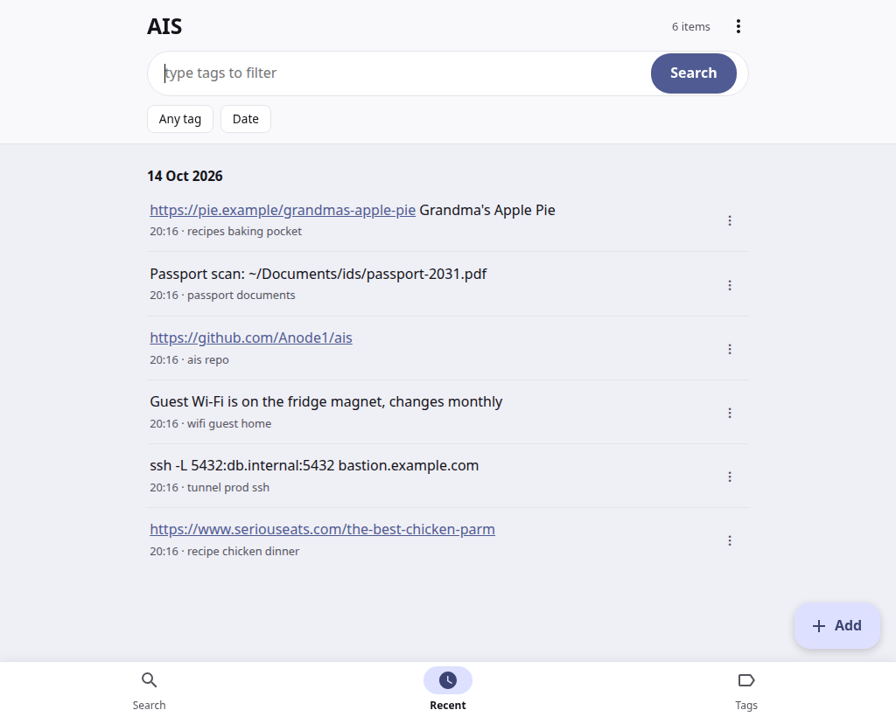
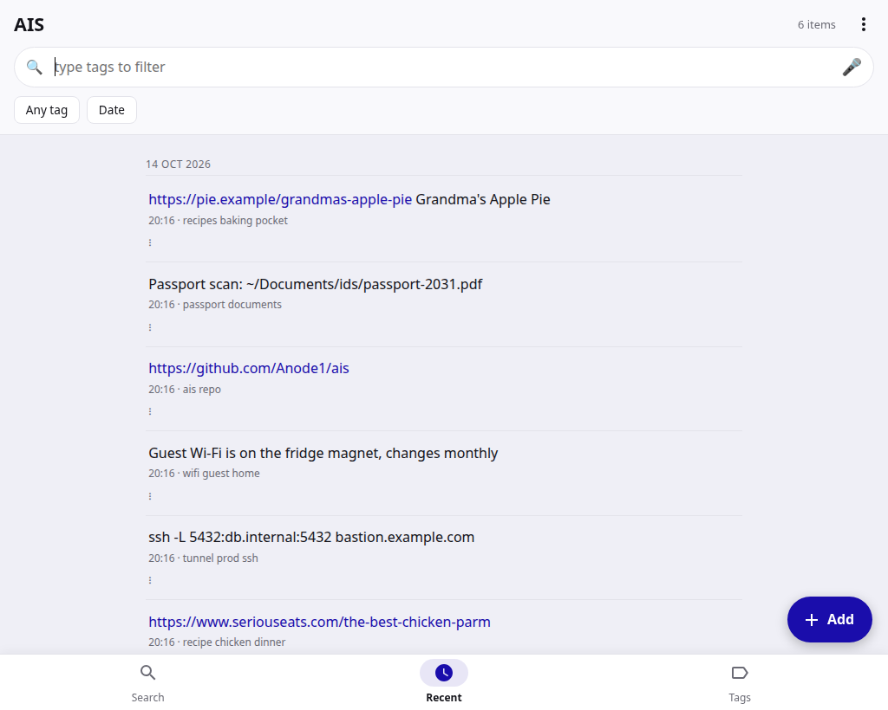

# GUI conventions (web, Flutter, native desktop)

> This file is what the surfaces must LOOK like. How to drive and test them
> without a human clicking (headless browser, Flutter by deep link and
> keyboard, a real APK on an emulator) is `doc/dev/GUI_TESTING.md`.

One product across surfaces: the same vocabulary and order on the web GUI (`c/serve.c`),
the PWA (`app/index.html` + `app/app.css`, served when `$AIS_WEB` points at `app/`),
and the Flutter app (`app/flutter/lib/main.dart`).

THERE ARE TWO WEB PAGES, and forgetting the second one is how it drifts. `c/serve.c`
carries an embedded page (the default) and `app/` is a separate installable PWA over the
same `/api`. They fell out of step badly once: the PWA ended up unable to render a
document or a secret at all, printing `aisdoc:`/`aisc:` base64 as body text, with no way
to encrypt or reveal, while the embedded page did all three. A feature added to one and
not the other is a bug. The element ids and function names are deliberately IDENTICAL
across the two so ONE driver (`tests/gui/cdptest.c`) runs against both; keep them that
way, and `tests/gui/ui.sh` renders both.
Change a label in one, change it in all three.

## Vocabulary (LOCKED)
- The primary action **and** the first view are both labeled **Search** (not "Get", not
  "Recall"). The keyboard return key already renders "Search" (`TextInputAction.search`), so
  button + tab + keyboard all read the same. One word per concept.
- The three views, in this order: **Search · Recent · Tags** in the phone-shaped
  bottom nav (Flutter, `serve.c`, the PWA). The middle one IS the timeline: the
  view id, the API and the desktop app all call it `timeline`, and only the
  phone nav label reads "Recent", because the label sits under an icon in a
  32px slot and "Recent" is what a phone user reads there.
- The create action is **Add**.
- Internal identifiers may keep their original names (`recall` / `getbtn` / `ID_GET` /
  `ID_VRECALL` / `_view=='recall'` / `data-v=recall`); only the **display labels** must read
  "Search". Renaming internals is optional churn, out of scope.

## Layout
- **Phone (Flutter):** search header on top; the three views in a bottom `NavigationBar`;
  Add as a FAB.
- **Web (`serve.c`) and the PWA (`app/`):** same, bottom nav + Add FAB. On the
  desktops this is the GUI; the Windows launcher (`gui/win/`) only opens it and
  draws nothing of its own but a tray menu (Open AIS, Quit AIS).

## The project chip

One tag a front end keeps active: first in the search bar and in the Add
sheet's tag field, chosen from the Tags view only. Recent lists only its items,
a search is ANDed with it, a new item gets it, and it is kept per device and per
library. The engine sees an ordinary tag. The behaviour, gestures and words are
in [project-chip/SPEC.md](project-chip/SPEC.md), with a mock beside it.

## The Due group (the wording, LOCKED)

A record filed under `due:YYYY[-MM[-DD]]` is due from that day. Each front end
asks the engine on open (`/api/due`, `ais_embed_due`) and shows the rows at the
top of Recent as a group headed **Due**, in the day headers' style, built by the
same row code as every Recent row: same tap, same menu, the due key visible on
the tag line. The group is absent when nothing is due, scrolls with the list,
takes no focus, and has no tint, no animation and no badge. At most five rows
show; a sixth line, **N more due**, expands the group in place. The record
keeps its place in its own day group below, and the group ignores the project
chip: a record is due whatever the user is working in.

Two actions, in the row menu above "Edit tags" on any row whose tag line
carries an elapsed due key, both edits that sync: **Done** detaches that key,
with the delete snackbar's Undo window ("Done" with Undo, as "Deleted" has),
and **Later** opens the date picker and rewrites the key to the chosen day,
`due:YYYY-MM-DD`. No dismiss, no snooze that hides without editing, no "Done
all", no confirmation dialog. The engine side is in LAYOUT.md, "Reminders: the
due key".

## The due date helper (the wording, LOCKED)

The Tags field of the Add sheet and the field of the Edit tags dialog carry a
calendar icon at their right end, inside the field, as the password fields
carry the reveal eye: a suffix icon, no row of its own, label and tooltip
**Remind me on a day**. Tapping it opens the date picker Later uses
(`showDatePicker`, 2000 to 2100; the pages an `<input type=date>`) and writes
`due:YYYY-MM-DD` into the field as text: appended after a space in the Add
sheet, committed as a chip in Edit tags, as a typed token is. The user sees the
tag and may edit it; a month, `due:2027-04`, or a year, `due:2027`, is typed by
hand. If the field already holds a `due:DATE` tag the picker replaces it.
Cancelling the picker changes nothing. Nothing else: no second field, no
toggle, no date stored apart from the tag.

The app's Help, under the heading **Reminders** (the pages have no Help
page): "A tag like
`due:2027-04-15` makes a note due from that day. It then waits under Due at
the top of Recent until you choose Done or Later from its menu. The calendar
icon beside Tags writes the tag for you; a month, `due:2027-04`, or a year,
`due:2027`, is a reminder too."

## Untag vs delete-under (the wording, LOCKED)

`--untag KEY` and `--del-under KEY` are one keystroke apart and opposite in
consequence, so every surface states the difference in the same words rather
than relying on the command name: the safe one names the TAG, the destructive
one names the RECORDS and their count, and the destructive one lists what it
would take before asking and points at the safe one. On the web pages the pair
sits on each tag row (`/api/untag`, `/api/del-under`); the destructive path also
requires the tag name to be typed, because it destroys records that are not on
screen, while the safe one runs a 5s undo window instead of a modal (nothing
reaches the engine until it lapses).

## Reference shots

Both web pages, one index, one viewport (1024x820), `#timeline`:

| `c/serve.c` (embedded) | `app/` (PWA) |
|---|---|
|  |  |

Regenerate against a throwaway index, never `~/.ais`:

    c/ais -f /tmp/ais-demo --init
    AIS_NO_OPEN=1 c/ais -f /tmp/ais-demo --serve 8801 &
    AIS_NO_OPEN=1 AIS_WEB=app c/ais -f /tmp/ais-demo --serve 8802 &
    tests/shot/shot.sh http://127.0.0.1:8801/#timeline screenshots/gui-web-embedded.png 1024x820
    tests/shot/shot.sh http://127.0.0.1:8802/#timeline screenshots/gui-web-pwa.png 1024x820

## History
The label drifted across surfaces (web/Flutter nav said "Search", the action button said
"Get", Win32 said "Recall"). Unified on **Search** for general-public clarity (avoids the
product-recall / MS-Recall ambiguity) and cross-platform consistency. Keep it that way.
